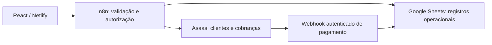

# Resenha Campo5 — memorial técnico

Referência de continuidade auditada em 29/10/2026. Este documento descreve o estado conhecido; não autoriza publicação, limpeza ou operação financeira. O código e os relatórios locais foram inspecionados; os serviços ativos não foram reconfigurados nem reexecutados para esta auditoria.

## Como interpretar as evidências

- **Código local:** comportamento encontrado nos arquivos auditados, que pode divergir do servidor.
- **Confirmado na homologação:** execução, leitura ou publicação registrada no relatório de 29/10, inclusive seu encerramento. Não significa que todos os cenários passaram.
- **Informado pelo usuário:** publicação/operação confirmada por ele, sem comparação integral do export ativo nesta auditoria.
- **Pendente:** implementação incompleta ou cenário ainda sem evidência suficiente.

A referência mais recente prevalece sobre instruções históricas. O encerramento do relatório de 29/10 substitui as antigas instruções de preservar os cadastros de teste: houve backup e limpeza autorizada. Isso não autoriza nova limpeza.

## Visão geral e arquitetura

O Resenha Campo5 oferece acesso por perfil, organização de peladas e convites, inscrição com cobrança, agenda pública e quadro da próxima partida.

O frontend consulta os webhooks sob `/webhook/rc5-app-v1`. O retorno financeiro usa `/webhook/resenha-status-asaas`. O navegador não acessa diretamente Google Sheets ou Asaas com credenciais. O Supabase e seus scripts SQL são históricos, sem uso no MVP atual.

A aplicação tem uma jornada conectada e uma demonstração legada. Não confundir fila, despesas ou pagamentos simulados em `App.tsx` com recursos operacionais. `src/main.tsx` permite a prévia `#/previa-paineis` apenas em desenvolvimento.

## Identidade, vínculos e permissões

O modelo conceitual separa identidade, papel administrativo e participação esportiva. A implementação atual concentra identidade e participação em JOGADORES, com CPF único e um vínculo principal `pelada_id`; não existe uma tabela normalizada de usuários com múltiplas associações de participação.

PELADAS.owner_id referencia JOGADORES.participante_id. Um OWNER pode criar e selecionar várias peladas próprias. ADMIN e jogador ficam limitados à pelada vinculada. O backend deve autorizar a seleção; mudar `pelada_id` no navegador não concede acesso.

| Perfil | Comportamento atual / regra |
| --- | --- |
| OWNER | Cadastro por convite exclusivo, login, criação e seleção de peladas próprias, administração e emissão de convite ADMIN |
| ADMIN | Lista privada e quadro administrativo da pelada vinculada; não concede OWNER nem deve promover outro ADMIN |
| Mensalista | Consulta do próprio cadastro, cobranças e participação; convites conforme autorização financeira do backend |
| Diarista | Participação financeira vinculada à data/jogo; consulta dos próprios dados |
| Público | Agenda e projeção reduzida do quadro, sem CPF, contatos ou cobranças |

Há divergência entre fontes antigas de convites e o pacote posterior: `convites-core.js.txt` admite ADMIN emitindo convite ADMIN, enquanto o teste atual de pacote exige exclusividade do OWNER. Conferir o ramo publicado antes de alterar essa regra. A tabela acima registra a regra pretendida/testada mais recente, não uma prova nova da configuração remota.

O OWNER pode jogar como mensalista usando a própria identidade e preservando o papel OWNER. A vinculação adicional usa cobrança com `pelada_id`; não há isenção automática. Isso não representa suporte genérico a qualquer jogador em múltiplas peladas.

## Planilhas e relacionamentos

Contratos são sensíveis a nomes de abas, ordem de colunas e, em alguns fluxos, ordem dos intervalos no snapshot. Verificar o cabeçalho real antes de editar. Identificadores abaixo são nomes de campos, sem valores de produção.

| Aba | Campos e vínculo principais |
| --- | --- |
| CONFIG | `chave`, `valor`; configuração geral, não cadastro de pelada |
| PELADAS | `pelada_id`, `nome`, `local`, `dia_semana`, `hora_inicio`, `hora_fim`, `mensalidade`, `diaria_sem_colete`, `diaria_com_colete`, `colete_avulso`, `vencimento_dia`, `convite_horas`, `owner_id`, `situacao` |
| JOGADORES | `participante_id`, `pelada_id`, `nome`, `apelido`, `cpf`, `telefone`, `email`, `categoria`, `papel_administrativo`, `situacao`, `asaas_customer_id`, `convidado_por_id`, `convidado_por_nome`, `criado_em`, `atualizado_em`, `senha_hash`, `token_sessao_hash`, `token_expira` |
| TOKENS_ACESSO | `token_hash`, `tipo_usuario`, `id_usuario`, `finalidade`, `expira_em`, `utilizado_em`; identidade referenciada depende do tipo |
| LIMITES_AUTH | `chave`, `acao`, `janela_inicio`, `contador`, `bloqueado_ate` |
| CONVITES | `convite_id`, `pelada_id`, `convidador_id`, `convidador_nome`, `telefone_destino`, `categoria_destino`, `emitido_em`, `expira_em`, `situacao`, `utilizado_em`, `participante_id`, `email_confirmado_em`, `apelido_destino`, `tipo_convite`, `jogo_id` |
| COBRANCAS | `payment_id`, `participante_id`, `jogo_id`, `tipo`, `competencia`, `vencimento`, `valor_bruto`, `status_asaas`, `data_pagamento`, `valor_recebido`, `taxa_asaas`, `valor_liquido`, `asaas_customer_id`, `subscription_id`, `invoice_url`, `atualizado_em`, `pelada_id` |
| MENSALIDADES | `participante_id`, `apelido`, `competencia`, `vencimento`, `valor`, `payment_id`, `subscription_id`, `status_asaas`, `pago_em`, `apto_financeiro`, `atualizado_em` |
| DIARIAS | `jogo_id`, `data_jogo`, `participante_id`, `apelido`, `convidador_id`, `convidador_nome`, `com_colete`, `valor`, `payment_id`, `status_asaas`, `pago_em`, `apto_financeiro` |
| CAIXA | `movimento_id`, `data_movimento`, `jogo_id`, `payment_id`, `categoria`, `descricao`, `valor_entrada`, `valor_saida`, `taxa`, `valor_liquido`, `situacao`, `registrado_por` |
| EVENTOS_ASAAS | `event_id`, `payment_id`, `tipo_evento`, `recebido_em`, `processado_em`, `resultado`, `tentativas`, `erro_resumido` |
| JOGOS_SCOUT | `jogo_id`, `data_jogo`, `horario`, `participante_id`, `apelido`, `categoria`, `presenca`, `colete`, `funcao`, `valor_combinado`, `pagamento_conferido`, `ocorrencias`, `registrado_por`, `atualizado_em`; existência da aba não comprova scout conectado |
| DASHBOARD | Agregações por pelada e fórmulas sobre cadastros/financeiro; preservar fórmulas |

`payment_id` liga cobrança, mensalidade/diária, evento e movimento financeiro. `participante_id` liga identidade aos registros. A coluna Q de COBRANCAS contém `pelada_id`; várias leituras ainda validam somente os primeiros 16 cabeçalhos e acessam Q separadamente. Registros antigos usam fallback pelo vínculo principal do jogador.

A sessão atual lê sete intervalos, nesta ordem: JOGADORES, TOKENS_ACESSO, LIMITES_AUTH, PELADAS, COBRANCAS, MENSALIDADES, DIARIAS. A agenda pública reutiliza essa ordem. Não remover um intervalo sem ajustar os índices e testes.

Named ranges funcionam como marcadores de unicidade/idempotência: famílias de cadastro, CPF, convite, cliente, cobrança, evento e crédito. Apagar linhas não remove marcadores; removê-los pode liberar duplicação. Backups devem preservar também metadados e fórmulas.

## Regras financeiras e da próxima partida

- Cadastro `ativo` e papel ADMIN/OWNER não comprovam pagamento.
- Mensalista: competência `AAAA-MM` da próxima partida, cadastro ativo, registro financeiro apto e status `CONFIRMED` ou `RECEIVED`, com cobrança correspondente.
- Diarista: pagamento da data/jogo correspondente e os mesmos requisitos financeiros. A agenda pública inclui somente diaristas registrados para essa data; o quadro autenticado ainda precisa uniformizar esse filtro.
- O próximo jogo é calculado em `America/Sao_Paulo`, a partir do dia semanal e horário final; após o fim do encontro, avança para a semana seguinte. Não há gestão completa de partidas extraordinárias/adiadas.
- Ordenação de exibição: administradores que participam, mensalistas e diaristas, depois apelido. Não equivale a uma fila esportiva persistida.
- Padrões editáveis do formulário: mensalidade 30, diária sem colete 15, com colete 20, colete avulso 5, vencimento dia 10, validade do convite 72 horas. São parâmetros do produto; não são valores financeiros individuais e não criam pelada antecipadamente.

## Workflows, endpoints e estado conhecido

Base pública: `https://n8n.saintsolution.com.br/webhook/rc5-app-v1`. Esta tabela combina código local com evidências do relatório. Nenhum export foi comparado integralmente com o servidor nesta auditoria documental.

| Método / caminho relativo | Fonte local de referência | Evidência / ressalva |
| --- | --- | --- |
| POST `cadastrar-organizador` | `scripts/owner-registration-core.js.txt`; pacote `workflows/para importar/RESENHA_CAMPO_5.json` | Cadastro por convite exclusivo descrito na entrega de 27/10; pacote completo é local e privado |
| POST `login`, GET `sessao`, POST `logout` | `src/lib/n8n/owner.ts`; exports 10–12 em `workflows/n8n/` | Acesso real homologado; sessão separada publicada segundo usuário |
| POST `peladas` | `workflows/n8n/17_criar_pelada_APP_MVP.json` | Criação autenticada pelo OWNER; export numerado não prova versão remota |
| POST/GET `convites` | Exports 14/15 e fontes de convites | Criação/listagem conectadas; conferir regra de promoção ADMIN na versão ativa |
| POST `validar-convite` | Export 16 | Abertura pública do convite; não confundir validação com inscrição concluída |
| POST `inscrever-jogador` | Export separado de inscrição e arquivos pontuais de reserva/finalização | Publicação informada; inscrição e retorno de pagamento homologados em cenários registrados |
| POST `meu-cadastro` | Export 18; sessão complementar | Edição do próprio apelido/contato; contato vinculado ao Asaas fica somente para consulta |
| GET `peladas-publicas` | Export 21 e arquivos da agenda | Instalação/publicação e funcionamento confirmados pelo usuário em 29/10 |
| POST `/webhook/resenha-status-asaas` | Export separado de retorno e três arquivos corrigidos | Recebimento real homologado em 29/10; fora da base `rc5-app-v1` |
| POST `criar-conta-pelada` | Export 13 e `bootstrap.ts` | Contrato legado de cadastro conjunto; não é a jornada atual de cadastro OWNER |

Fontes pontuais mais recentes:

- [Sessão com jogadores, cobranças e próxima partida](<../workflows/Consulta Sessao Resenha Camp 5./ATUALIZAR_SESSAO_COBRANCAS.code.txt>).
- [Agenda pública](<../workflows/Agenda publica com participantes/PREPARA_AGENDA_PUBLICA.code.txt>).
- [Reserva de inscrição](<../workflows/Quadro pelada e owner mensalista/RESERVA_INSCRICAO.code.txt>) e [finalização](<../workflows/Quadro pelada e owner mensalista/FINALIZA_INSCRICAO.code.txt>).
- [Planejamento do retorno Asaas](<../workflows/Retorno Asaas corrigido/03_PLANEJAR_ATUALIZACAO.code.txt>).

Esses caminhos existem na árvore local auditada, mas alguns são privados/não versionados. Um clone público pode não contê-los. Solicitar ao responsável exports atuais sanitizados por canal apropriado; não publicar os arquivos privados para resolver links ausentes.

Os diretórios de etapas, restauração, originais e `novo n8n` contêm versões históricas/alternativas. Arquivos `ESTRUTURAL` usam contratos fictícios isolados e não são instrução de produção. O campo `active` do export reflete apenas o momento da exportação. Há exports da mesma sessão com valores divergentes desse campo.

O gerador manual de convite OWNER foi observado no navegador na sessão operacional anterior; a sua versão ativa não foi exportada/comparada nesta auditoria. Não executar o gerador apenas para verificar documentação. Manter somente um webhook ativo por método/caminho; a separação de sessão/inscrição/retorno exige conferir ramos antigos do workflow principal.

## Asaas e tratamento de pagamentos

A inscrição consulta cliente pelo CPF e grupo exato `Pagamentos Pelada`: zero resultados permite criação nesse grupo, um permite reutilização, múltiplos exigem conciliação. Essa regra está registrada na homologação de 28/10. Não selecionar arbitrariamente cliente duplicado.

A reserva antecede emissão externa e finalização no Sheets. Não existe transação distribuída entre Asaas e planilha: uma cobrança pode existir mesmo se o lote final falhar. Em resultado incerto, consultar cobrança, registros e marcadores antes de repetir. O finalizador deve chamar `finalize19`, não `reserve19`; o incidente e sua correção estão preservados no relatório de 29/10.

O retorno autenticado aceita `PAYMENT_CONFIRMED`, `PAYMENT_RECEIVED` e `PAYMENT_OVERDUE`. Atualiza cobrança, mensalidade/diária e aptidão; movimento de CAIXA é associado ao recebimento. Marcadores por evento/crédito evitam repetição e há proteção contra regressão por evento anterior. Cancelamento, estorno e ciclo completo de reconciliação ainda exigem definição e homologação.

A autenticação gerenciada deve ficar no n8n; origem/CORS não confere identidade. IDs reais de evento contendo `&` exigiram correção da validação e codificação do marcador. O Webhook deve responder pelo nó de resposta configurado, conforme o fluxo publicado; uma execução verde não basta para comprovar resposta correta ao Asaas.

Homologação registrada: pagamento real de participante de teste confirmado como `RECEIVED`, com atualização da mensalidade e movimento único no CAIXA. O encerramento de 29/10 também confirmou pagamento da mensalidade do OWNER, aptidão e movimento correspondente antes da limpeza. Os nomes, valores individuais e identificadores estão omitidos nesta documentação para Git.

**OWNER mensalista não deve ser descrito simplesmente como “sem validação financeira”: houve evidência positiva de um caso.** A implementação permanece limitada: recorrência, associação em múltiplos cenários e recuperação de falhas não estão integralmente homologadas. Inscrição inicial não equivale a assinatura mensal automática.

## Telas, rotas e componentes

O roteamento atual usa hash e estado em `OwnerAccess.tsx`, sem React Router.

| Entrada / componente | Função |
| --- | --- |
| `#/` / `Landing` | Apresentação, agenda pública, abertura do quadro e entrada |
| `#/entrar` / `OwnerAccess` | Login por CPF/senha e consulta da sessão |
| `#/admin`, `#/criar-pelada` | Aliases atuais para login; não garantem privilégio nem criação direta |
| `#/cadastrar-owner` | Convite exclusivo recebido pelo canal operacional; token mantido em memória e removido da URL pela tela |
| `#/convite` / `InvitationAccess` | Validação e inscrição por convite |
| `AccessPanel` | Painel conforme perfil e pelada selecionada |
| `PlayerList` | Cartões, filtros, ficha administrativa e cobranças existentes |
| `MatchBoard` | Quadro, aptidão, rascunhos de campo e impressão |
| `MatchHistory` | Seleção de data; informa indisponibilidade sem histórico recebido |
| `PersonalDetails` | Cadastro do titular; restrição de contato vinculado ao Asaas |
| `InviteManager` | Emissão/listagem e link para compartilhamento pelo WhatsApp |
| `OwnerEnrollment` | Inscrição do próprio OWNER como mensalista |
| `PeladaFields` | Formulário editável da pelada |
| `#/previa-paineis` / `DashboardPreview` | Prévia somente DEV, sem prova de comportamento real |

O token de sessão real fica no estado React, não em armazenamento persistente. Recarregar exige novo acesso. `localStorage` em `demo.ts`/`App.tsx` pertence à demonstração. O contexto de autenticação e os tipos de domínio antigos não substituem o contrato de `src/lib/n8n/owner.ts`.

## Funcionalidades implementadas e limites

Implementadas/conectadas: acesso por perfil, cadastro exclusivo de OWNER, criação de pelada autenticada, convites e inscrição, consulta de cobrança existente, retorno financeiro em cenários homologados, agenda pública, quadro por competência/data, fichas privadas, indicação de convidador para OWNER/ADMIN e impressão pelo navegador.

Parciais: presença/chegada/pagamento conferido são rascunhos em memória; histórico tem interface sem persistência; OWNER mensalista tem cenário financeiro confirmado sem ciclo recorrente completo; impressão reproduz os dados disponíveis e não cria presença salva. Visualização completa de todos os perfis/dispositivos e diarista com/sem colete ainda precisa de homologação sistemática.

Não implementados como operação persistida: scout esportivo, gols/assistências/placares/rankings, gestão completa de partidas extras/adiadas, fila esportiva compartilhada e renovação mensal automática.

## Problemas conhecidos e prioridades

1. **Limite de sessão:** o código de sessão aplica limite GLOBAL de 30 ações por 15 minutos; polling a cada 30 segundos pode esgotar a cota. Redesenhar leitura de sessão sem enfraquecer login/recuperação. Consulta de sessão também grava limite, portanto não é um teste operacional sem efeito.
2. Atualizar os dois testes obsoletos registrados abaixo e fortalecer isolamento de peladas, jogo e competência.
3. Uniformizar seleção de diaristas do quadro autenticado e contadores com OWNER participante.
4. Conferir a regra de emissão de convite ADMIN na fonte realmente publicada; fontes locais divergem.
5. Extrair cálculo compartilhado do quadro e projeções pública/privada. Hoje a agenda monta internamente dados administrativos antes de reduzi-los e lê tabelas de autenticação sem necessidade funcional.
6. Definir identidade persistente da partida e salvar presença/ordem/alterações com autoria, horário, idempotência e concorrência entre administradores.
7. Planejar recorrência, cancelamento/estorno e recuperação de emissão com falha de gravação.
8. Revisar autenticação legada: SHA-256 simples é compatibilidade do MVP, não KDF adequado para senha. Não confundir fluxos fictícios de recuperação/e-mail com um serviço de recuperação homologado.
9. Modelo de participação ainda tem um vínculo principal por jogador; ampliar relações requer desenho próprio.

## Testes e validação

Auditoria documental de 29/10/2026: `npm test` executou 98 testes, 96 passaram, dois falharam:

| Arquivo | Falha encontrada | Encaminhamento |
| --- | --- | --- |
| `tests/bootstrap-frontend.test.mjs` | Espera mensalidade inicial `NaN`, anterior aos padrões editáveis do commit c7bf023 | Atualizar expectativa ao requisito aprovado, preservando validações de formulário |
| `tests/match-roster.test.mjs` | Fixture de agenda antiga recebe 503 em vez de 200; snapshot não acompanha sete intervalos | Atualizar fixture e testar projeção pública sem dados privados |

Nenhum teste foi alterado nesta organização documental. Os sete testes do painel, typecheck, lint e build passaram na publicação anterior dos padrões. Não foram repetidos todos esses comandos na auditoria documental; não declarar a suíte atual totalmente verde. Alguns testes dependem de fontes/exports privados locais, por isso um clone público pode executar ou ignorar casos diferentes.

## Segurança, homologação e continuidade

1. Ler este memorial, decisões, changelog e encerramento do relatório de 29/10. Inspecionar `git status` antes de editar: há alterações locais e arquivos privados fora do Git.
2. Confirmar o objetivo e obter a versão ativa do fluxo relevante; comparar nós e contratos antes de usar geradores antigos. Não importar pacotes completos sobre canvas preenchido por conveniência.
3. Isolar ambiente, planilha, webhooks e Asaas de teste antes de ensaios que gravam. Não usar credenciais de produção no frontend nem registrar payloads com dados pessoais.
4. Testes de transporte usam mocks; homologação real é etapa distinta. Não reexecutar tentativas financeiras antigas como teste genérico, nem emitir outra cobrança para recuperar um link.
5. Conferir método/caminho, CORS, autenticação gerenciada, nomes dos nós e modo de resposta. Expression colada manualmente no n8n começa com `{{ ... }}`; export JSON usa `={{ ... }}`; URL fixa começa diretamente com `https://`.
6. Erro após emissão exige conciliação antes de repetição. Conferência manual de campo nunca fabrica status Asaas, aptidão ou crédito em caixa.
7. Nunca versionar exports privados, backups com dados, links de convite, credenciais, hashes reais ou informações financeiras individuais. Documentar nomes de variáveis e procedimentos, sem valores secretos.
8. Não executar limpeza sem autorização específica e backup verificado. Preservar configuração, estrutura e fórmulas; avaliar marcadores e dependências externas.

## Estado de entrega e próxima sessão

Em 29/10, houve backup completo e limpeza autorizada das 11 abas operacionais, preservando CONFIG, cabeçalhos e fórmulas do DASHBOARD. Removidos 21 marcadores de cadastro/convite/inscrição; quatro marcadores de eventos/créditos anteriores foram mantidos como proteção contra reprocessamento. Asaas não foi alterado pela limpeza. O backup é privado e deve ser localizado pelo responsável, sem publicá-lo no Git.

No encerramento dessa operação, contas/sessões/convites antigos ficaram inválidos e um novo convite OWNER era necessário. Não presumir que esse continua sendo o estado ao retomar: consultar o responsável antes de qualquer ação. Não limpar uma segunda vez.

Próxima sessão sugerida: corrigir o limite de consultas e os testes, obter inventário atualizado dos fluxos ativos, acompanhar o novo OWNER e homologar diarista. Depois definir presença/histórico; discutir métricas e regras do scout antes de construir tabelas e telas.

## Documentos históricos e organização futura

O README anterior misturava demonstração, cadastro conjunto e operação real. Foi substituído por uma entrada atual. `backend-status.md` passa a apontar para este memorial. Os demais relatórios e propostas são preservados e indexados, com datas e contexto próprios.

Há sobreposição entre `ENTREGA_ACESSO_UNICO_CADASTRO.md`, `DASHBOARD_POR_PELADA.md`, `PAINEIS_REACT_2026-10-29.md`, propostas n8n e relatórios diários. Recomenda-se futuramente arquivar cópias sanitizadas por data e reduzir instruções duplicadas, após conferir referências. Nenhum workflow ou diretório operacional foi movido/removido nesta entrega.

A marca documental é **Resenha Campo5**. Nomes antigos que ainda apareçam em caminhos, código, credenciais ou exports são identificadores legados; não foram renomeados sob uma autorização limitada à documentação.
